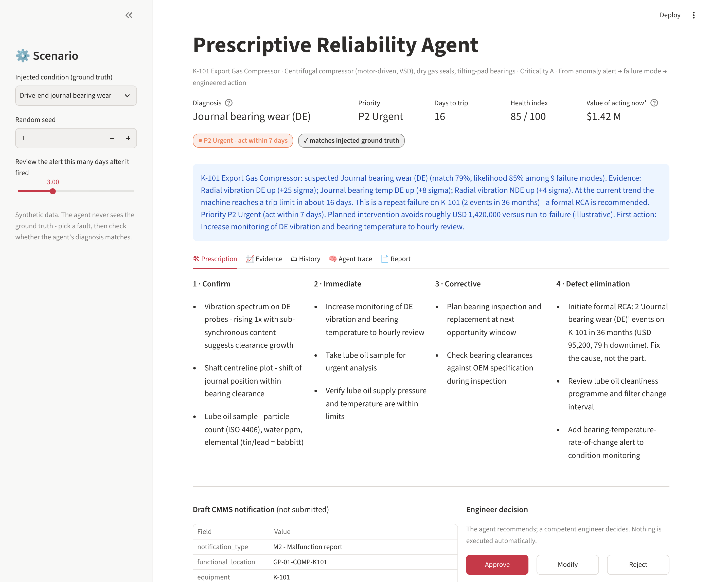
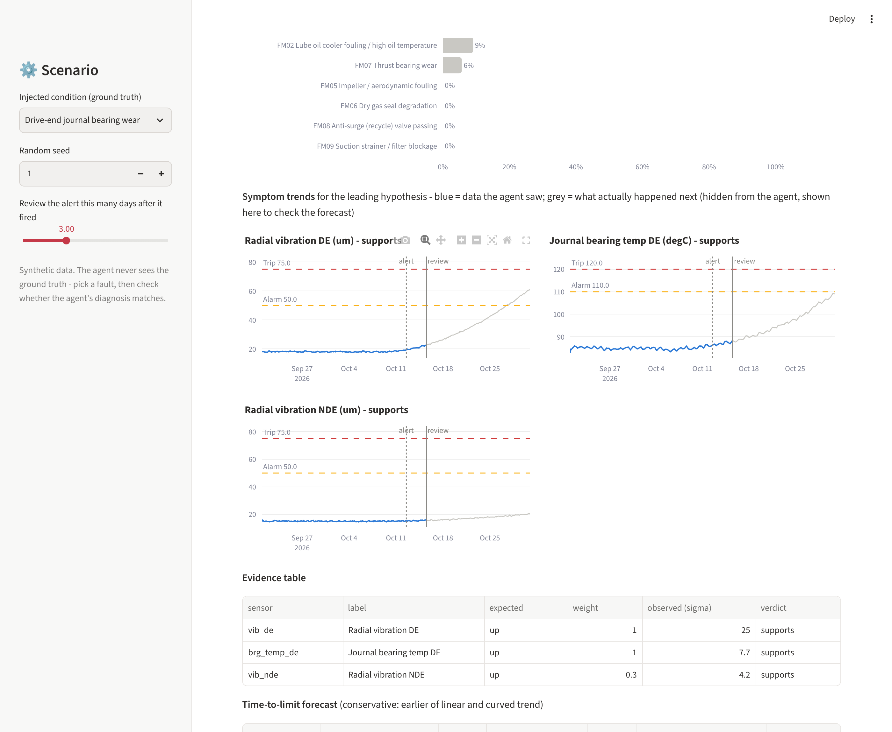

# Prescriptive Reliability Agent

**From "something is wrong" to "here is what's failing, why, how urgent it is, and what to do."**
**▶ Live demo:** https://k101-reliability-agent.streamlit.app — pick a fault in the sidebar and check whether the agent's diagnosis matches the injected ground truth.

Condition-monitoring and predictive-maintenance platforms are now good at *detecting* that equipment is
unhealthy. The expensive part still happens afterwards, by hand: a reliability engineer works out the failure
mode, checks the history, judges urgency, and decides what to do — and whether to stop it recurring.

This project automates that **reliability-engineering layer** for a centrifugal gas compressor. It combines
anomaly detection with an engineer-curated **FMEA knowledge library**, maintenance **work-order history**, and
**time-to-trip forecasting**. The result is an auditable, prioritised prescription and a draft CMMS
notification for an engineer to approve.



## Results (held-out evaluation, synthetic data)

| Metric | Result |
|---|---|
| Faults detected | **100%** (90/90 cases) |
| False alarms on healthy machines | **0%** |
| Warning before the conventional alarm limit (median) | **~15 days** |
| Correct failure mode at alert + 3 days (top-1 / top-3) | **97% / 100%** |
| Correct failure mode at first alert (top-1 / top-3) | 91% / 99% |
| Wrong diagnoses the agent itself flagged as uncertain | **3 of 3** |

9 failure modes × 10 random seeds, on seeds never used while tuning. Full breakdown and limitations:
[docs/evaluation.md](docs/evaluation.md).

## What the agent does

```
 sensor data ──► 1 CHECK      persistent, meaningful anomaly?            detect.py
                 2 DIAGNOSE   which FMEA failure mode fits the symptoms?  diagnose.py + knowledge/fmea_*.yaml
                 3 DOUBT      clear winner, or run a discriminating test? agent.py
                 4 RECALL     happened before? bad actor?                 history.py (text search on work orders)
                 5 FORECAST   days to alarm / trip at current trend       detect.time_to_limit
                 6 DECIDE     priority = severity × confidence × time × criticality
                 7 VALUE      planned intervention vs run-to-failure (illustrative)
                 8 PRESCRIBE  confirm → immediate → corrective → defect elimination (+ RCA if repeat)
                 9 DRAFT      SAP PM-style M2 notification with ISO 14224 codes
                10 HAND OVER  engineer approves — nothing is executed automatically
```

Every step is written to a **reasoning trace**, so any recommendation can be traced back to sensor evidence
and FMEA logic. If a recommendation can't be explained, it won't be acted on in a plant.



## Design choices that matter in industry

- **The engineering knowledge is data, not code.** Failure modes, symptom signatures, confirmation checks and
  actions live in [`knowledge/fmea_centrifugal_compressor.yaml`](knowledge/fmea_centrifugal_compressor.yaml).
  A reliability engineer can extend it to pumps, turbines or valves without writing Python.
- **"Real and meaningful."** A deviation counts only if it is statistically unusual **and** uses a meaningful
  share of the margin to its alarm limit, and only if it moves *towards* that limit. This is what removed
  false alarms.
- **Honest about uncertainty.** When look-alike failure modes score close together, the agent doesn't guess.
  It recommends the specific test that tells them apart, for example a vibration spectrum for 1x vs 2x.
- **Conservative forecasting.** Time-to-trip uses the earlier of a straight-line and a curved trend, because
  degradation usually accelerates along the P-F curve.
- **Messy CMMS data handled.** About 30% of past failures are deliberately left uncoded. Text search with plant
  shorthand expansion ("DE brg high vib" → "drive end bearing high vibration") still finds them.
- **Deterministic core, optional LLM.** All engineering decisions are rule- and evidence-based and fully
  reproducible. An LLM (Anthropic or OpenAI) can optionally write the summary text from the structured
  findings, and is not allowed to add facts.
- **No ground-truth leakage.** The simulator's fault physics is written separately from the FMEA library and
  includes secondary effects the FMEA doesn't list. The agent is never shown the answer.

## Run it

```bash
pip install -r requirements.txt
streamlit run app.py                 # interactive dashboard
python run_demo.py                   # all 10 scenarios -> reports/*.md and *.json
python run_demo.py --evaluate        # accuracy evaluation -> docs/evaluation.md
```

Optional LLM summary: `export ANTHROPIC_API_KEY=...` (or `OPENAI_API_KEY`) and `export PRA_USE_LLM=1`.

Sample output: [reports/bearing_wear_de.md](reports/bearing_wear_de.md)

## Project structure

```
knowledge/   asset_k101.yaml (sensors, alarm/trip limits)  ·  fmea_centrifugal_compressor.yaml (9 failure modes)
src/pra/     simulate.py · detect.py · diagnose.py · history.py · agent.py · narrative.py · report.py · evaluate.py
app.py       Streamlit dashboard
run_demo.py  command-line runner and evaluation
docs/        evaluation results, screenshots, how-it-works explainer
reports/     generated assessments for each scenario
```

## Scope and limitations

- **All data is synthetic.** It uses typical engineering values, not any operator's data. Fault signatures are
  engineering-informed but simplified.
- **Single asset type, single faults.** Real plants have instrument faults, operating-mode changes and
  overlapping failures.
- **Economics are illustrative.** They show the decision logic, not a business case for a specific site.
- **Path to production:** calibrate on historian and CMMS data from one critical asset, connect to the
  existing condition-monitoring alert feed, and capture engineer approve/modify/reject feedback to improve
  the FMEA library over time.

## Author

**Dipti Roy Choudhary** — Reliability Engineer (Instrumentation & Control), TÜV Rheinland Functional Safety
Engineer (SIS). Building AI that thinks like a reliability engineer.

*Independent portfolio project. Not affiliated with, or based on data from, any employer or operator.*
